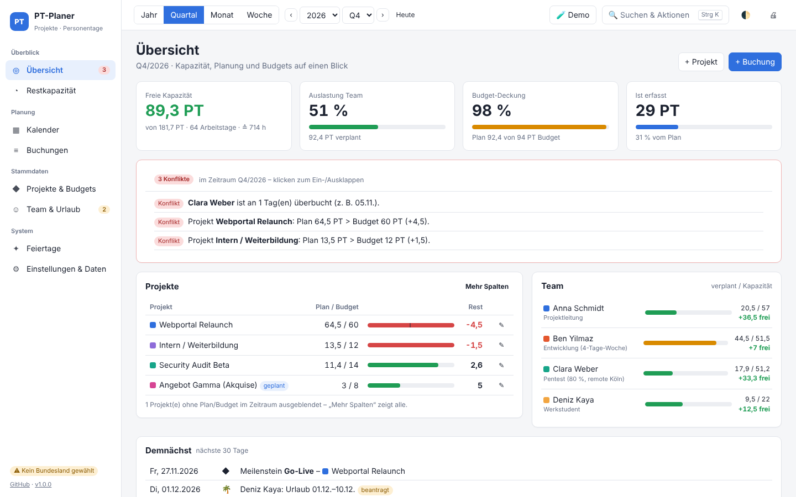
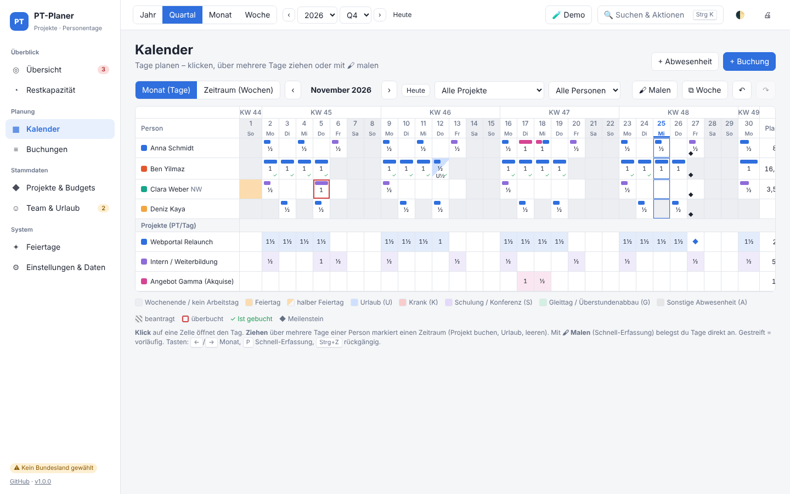
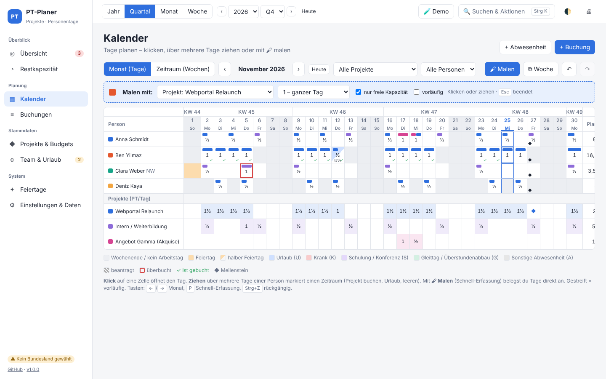
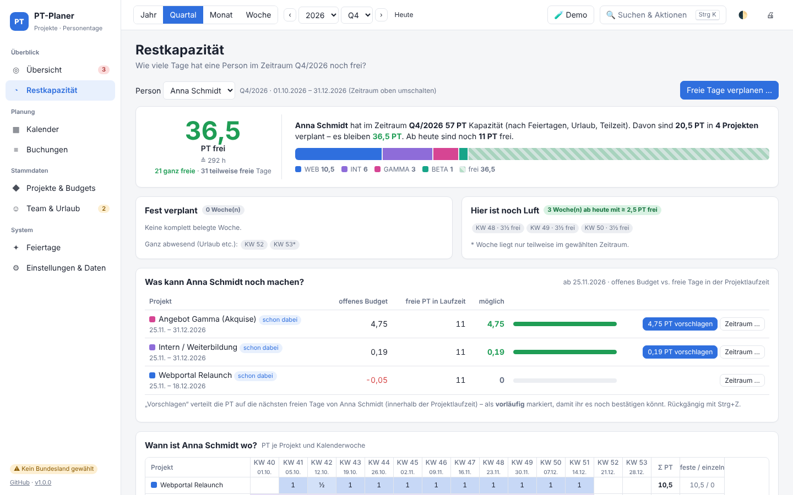
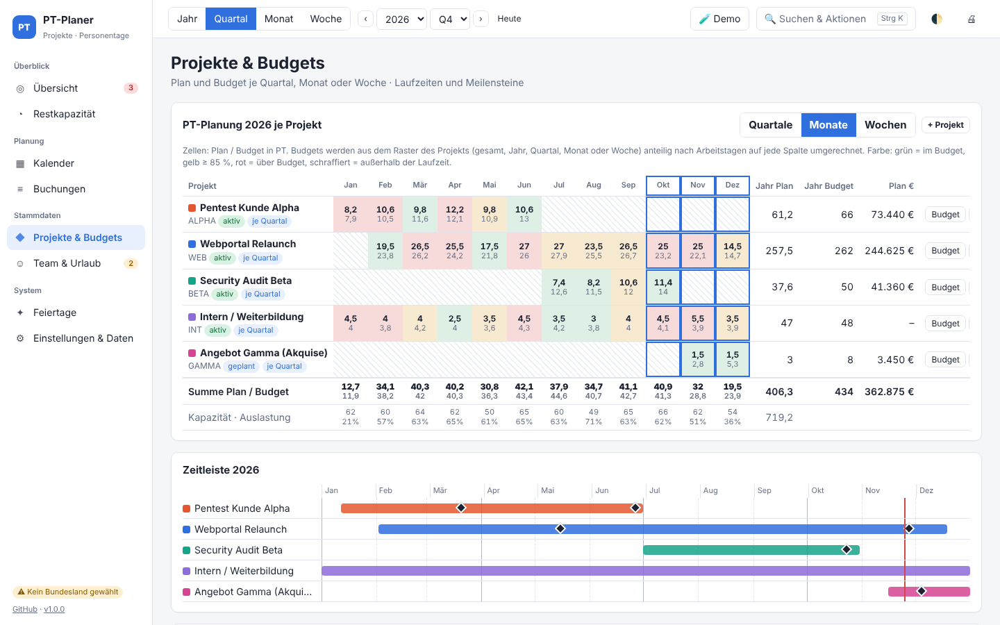
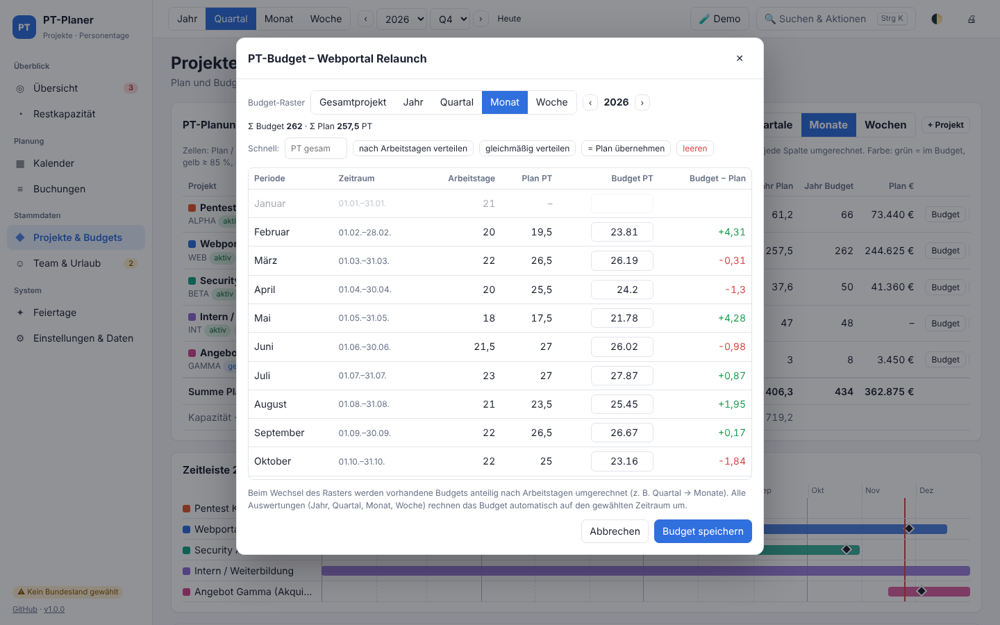
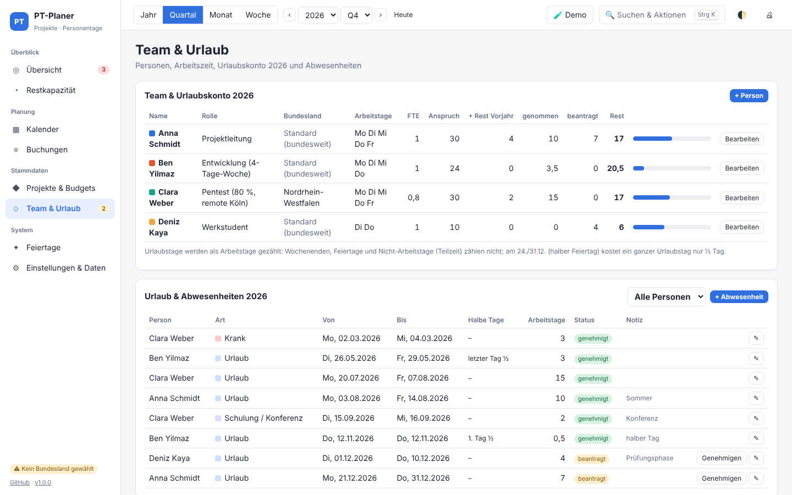
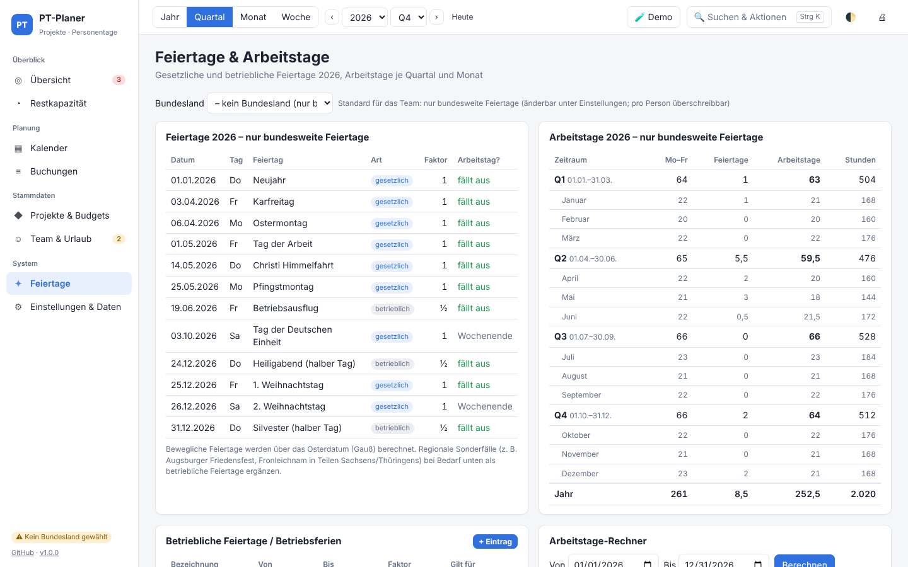
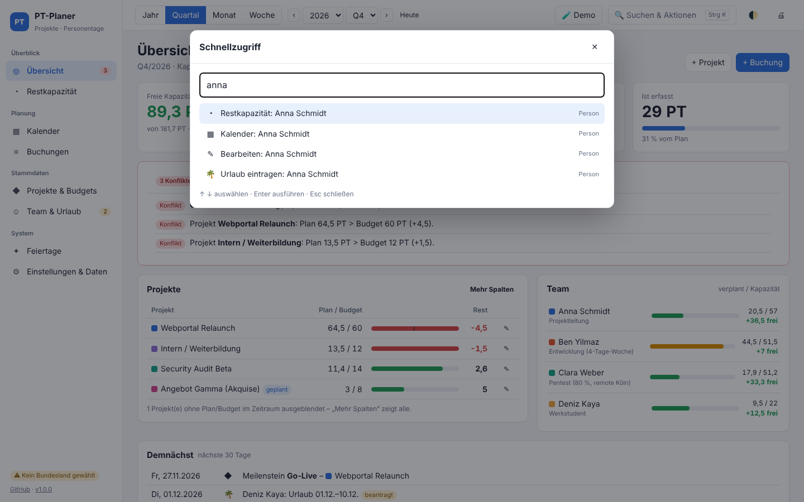
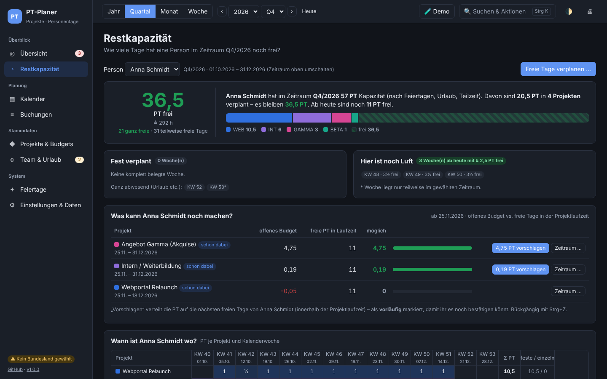

# PT-Planer

**Projekt- und Ressourcenplanung in Personentagen – als eine einzige HTML-Datei.**

Plane, wer wann an welchem Projekt arbeitet, wie viele Tage noch frei sind und ob die Budgets reichen – mit automatisch berechneten Feiertagen für alle 16 Bundesländer, Urlaub, Teilzeit und halben Tagen. Kein Server, keine Installation, kein Konto: Datei im Browser öffnen und loslegen.

  



---

## Schnellstart

1. `pt-planer.html` herunterladen.
2. Im Browser öffnen (Chrome, Edge, Firefox, Safari).
3. Oben **🧪 Demo** klicken, um mit Beispieldaten auszuprobieren – oder unter **Übersicht → Erste Schritte** das eigene Team anlegen.
4. **Bundesland wählen** (Einstellungen & Daten). Es ist bewusst keines vorausgewählt – bis dahin zählen nur die bundesweiten Feiertage, erkennbar am Hinweis „⚠ Kein Bundesland gewählt“ unten in der Seitenleiste.

Deine Daten bleiben lokal im Browser. Für Backups und Weitergabe: **Einstellungen & Daten → Export JSON**.

---

## Funktionen

### Planung


| Funktion | Beschreibung |
|---|---|
| **Personentage (PT)** | Buchungen mit 1 / 0,75 / 0,5 / 0,25 PT pro Tag, als *Plan* oder *Ist* |
| **Feste Wochentage** | z. B. „jeden Di–Do ganztägig Projekt X“ – Feiertage und Urlaub werden automatisch ausgelassen |
| **Ganze Wochen / Zeiträume** | im Kalender über mehrere Tage ziehen oder per Von–Bis buchen |
| **🖌 Malen** | Projekt, Urlaub oder „leeren“ wählen und Tage direkt anmalen (Taste `P`) |
| **Woche kopieren** | Buchungen einer Woche in Folgewochen fortschreiben |
| **Vorläufige Buchungen** | Optionen/Angebote gestreift markieren und später bestätigen |
| **Nur freie Kapazität** | Buchen füllt nur Lücken – keine Überbuchung |
| **Projektlaufzeit** | Buchungen vor Start oder nach Ende eines Projekts werden verhindert |



### Kapazität & Restkapazität


- Kapazität je Person aus Arbeitstagen, Teilzeitfaktor (FTE), Feiertagen und Abwesenheiten
- **Restkapazität**: Wie viele Tage hat jemand im Zeitraum noch frei – gesamt und ab heute
- Wochenmatrix „Wann ist wer wo?“, Mini-Kalender der freien Tage (grün = ganz frei, geteilt = teilweise verplant)
- Fest verplante Wochen und Wochen mit freier Luft auf einen Blick
- **„Was kann … noch machen?“**: offene Projektbudgets vs. freie Tage – mit automatischem Vorschlag



### Budgets & Auswertung


- Budget je Projekt im Raster **Gesamt, Jahr, Quartal, Monat oder Woche**
- Auswertung in jedem Zeitraum – Budgets werden anteilig nach Arbeitstagen (innerhalb der Projektlaufzeit) umgerechnet
- Plan vs. Budget vs. Ist, Kosten über Tagessatz
- Konflikte & Hinweise: Überbuchung, Budget überschritten, Buchung auf Feiertag/Urlaub, außerhalb der Laufzeit



### Feiertage, Urlaub, Abwesenheiten
- Gesetzliche Feiertage aller 16 Bundesländer, bewegliche Feiertage über das Osterdatum berechnet
- **Kein Bundesland vorausgewählt** – ohne Auswahl gelten nur die bundesweiten Feiertage
- Pro Person abweichendes Bundesland (z. B. Remote-Mitarbeitende)
- 24.12. und 31.12. optional als halbe Arbeitstage, eigene Betriebsferien / betriebliche Feiertage
- Urlaubskonto: Anspruch, Rest Vorjahr, genommen, beantragt, Rest – gezählt werden nur echte Arbeitstage
- Abwesenheitsarten: Urlaub, Krank, Schulung, Gleittag, Sonstiges – ganz- oder halbtägig, beantragt/genehmigt
- Brückentage und Arbeitstage-Rechner

| Team & Urlaub | Feiertage & Arbeitstage |
|---|---|
|  |  |

### Bedienung
- Zeitraum oben wählen: **Jahr / Quartal / Monat / Woche**, blättern mit `‹ ›`
- **Schnellzugriff** mit `Strg+K` (z. B. „budget web“, „urlaub mark“)
- Rückgängig / Wiederholen: `Strg+Z` / `Strg+Y`
- Hell- und Dunkelmodus, Druckansicht
- **Demo-Modus** mit Beispieldaten, getrennt von den eigenen Daten

| Schnellzugriff (Strg+K) | Dunkelmodus |
|---|---|
|  |  |

### Export
- JSON-Backup (enthält App-Version und Exportzeitpunkt) und Import
- CSV (Semikolon, Excel-tauglich): Tagesplanung, Plan/Budget je Quartal, Monat oder Woche
- Kalenderdatei `.ics` mit Feiertagen, Abwesenheiten und Meilensteinen

---

## So rechnet der Planer

| Größe | Berechnung |
|---|---|
| **Kapazität / Tag** | Arbeitstag der Person (1/0) × (1 − Feiertagsfaktor) − Abwesenheit, × FTE |
| **Plan** | Einzelbuchungen (Plan) + feste Wochentage. Feste Wochentage füllen nur freie Kapazität. Eine Einzelbuchung desselben Projekts am selben Tag ersetzt den festen Tag (0 = Tag aussetzen). |
| **Ist** | Einzelbuchungen vom Typ *Ist*, getrennt vom Plan |
| **Frei** | Kapazität − Plan |
| **Budget im Zeitraum** | anteilig nach Arbeitstagen innerhalb der Projektlaufzeit, z. B. 60 PT im Quartal → 20 PT in einem Monat mit einem Drittel der Arbeitstage |
| **Urlaubstag** | zählt nur an Arbeitstagen; am 24./31.12. (halber Feiertag) kostet ein ganzer Urlaubstag ½ Tag |

---

## Daten & Datenschutz

- Alles bleibt **lokal im Browser** (`localStorage`) – es werden keine Daten übertragen, es gibt keine externen Abhängigkeiten.
- Die Daten hängen an Browser und Speicherort der Datei. Wer die Datei verschiebt oder den Browser-Speicher leert, sollte vorher **Export JSON** nutzen und danach wieder importieren.
- Der Demo-Modus speichert in einem eigenen Bereich und lässt die eigenen Daten unberührt.

---

## Versionen

| Version | Datum | Änderungen |
|---|---|---|
| **1.0.0** | 25.11.2026 | Erste veröffentlichte Version: Planung in PT, feste Wochentage, Malen/Ziehen, Woche kopieren, vorläufige Buchungen, Restkapazität mit Vorschlägen, Budget-Raster Gesamt/Jahr/Quartal/Monat/Woche, Feiertage aller Bundesländer, Urlaubskonto, Demo-Modus, Schnellzugriff, Export JSON/CSV/ICS, Prüfung der Projektlaufzeit, kein vorausgewähltes Bundesland |

Neue Versionen: [Releases](https://github.com/NoAuthZone/PT-Planer/releases) · Fehler und Ideen: [Issues](https://github.com/NoAuthZone/PT-Planer/issues)

---

## Projektstruktur

```
PT-Planer/
├── pt-planer.html   # die komplette Anwendung (HTML, CSS, JavaScript in einer Datei)
├── README.md
├── LICENSE
└── img/             # Screenshots für diese README (Demo-Daten)
```

---

## Lizenz

[MIT](LICENSE)
